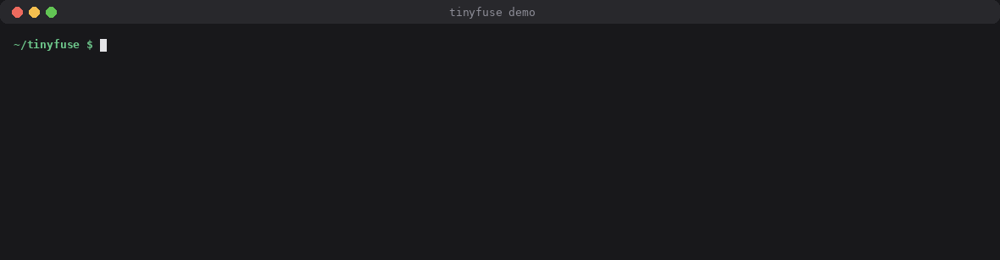
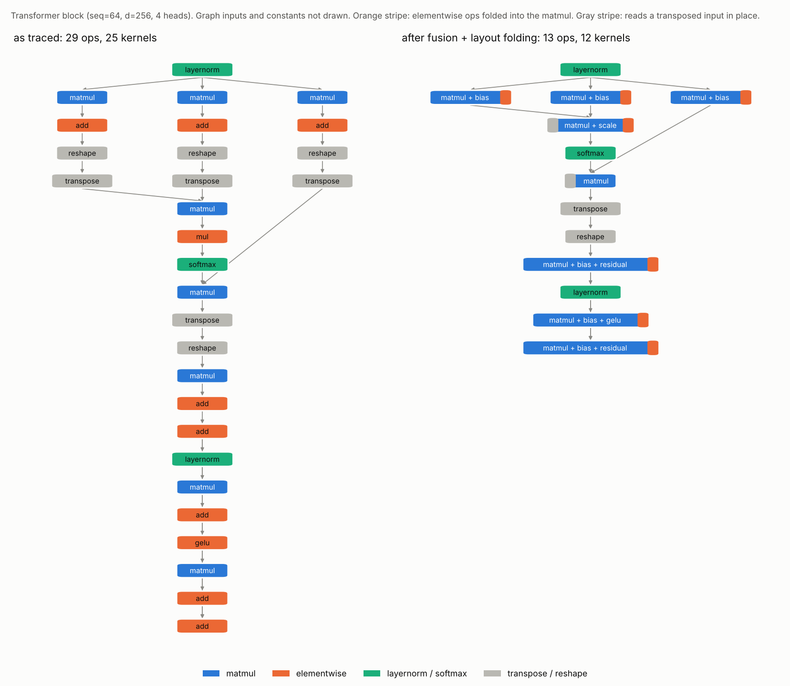
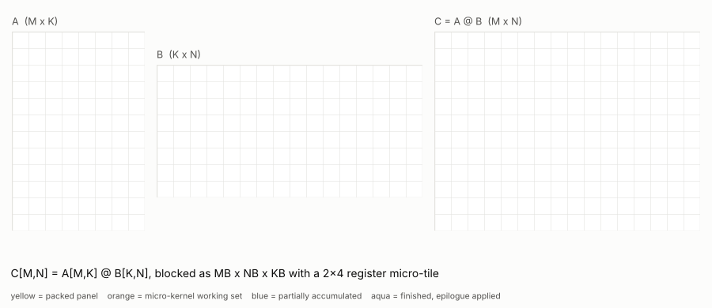
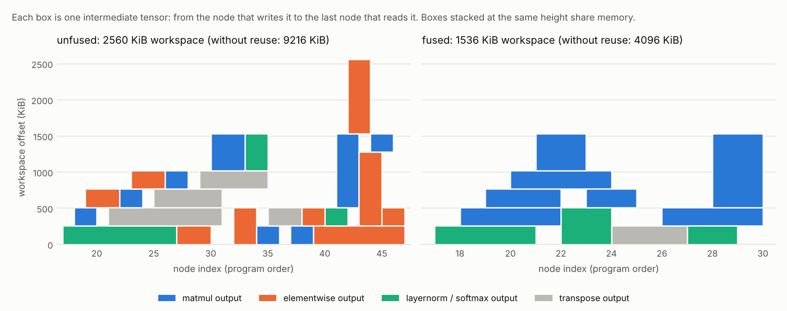
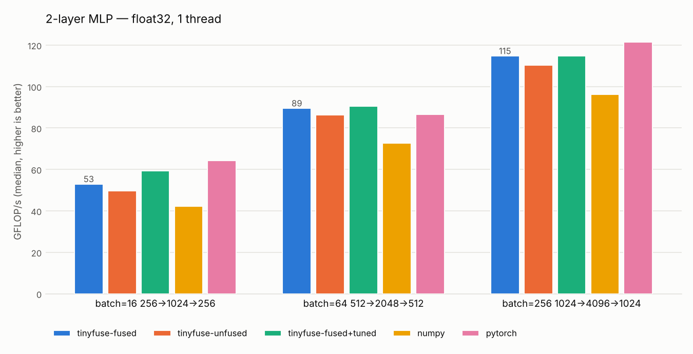
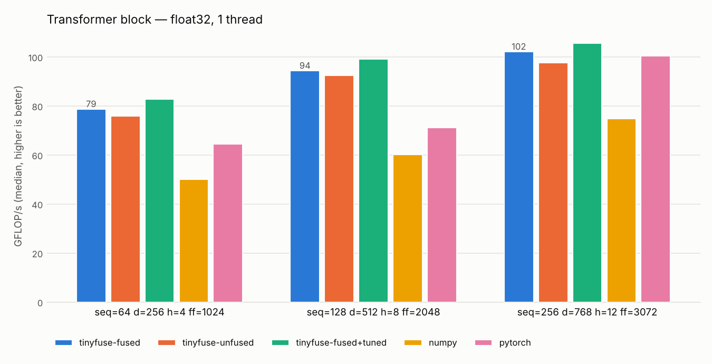
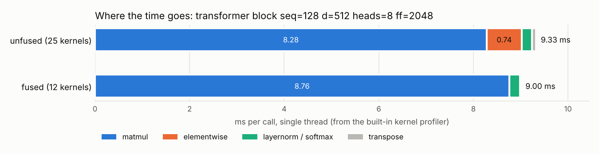
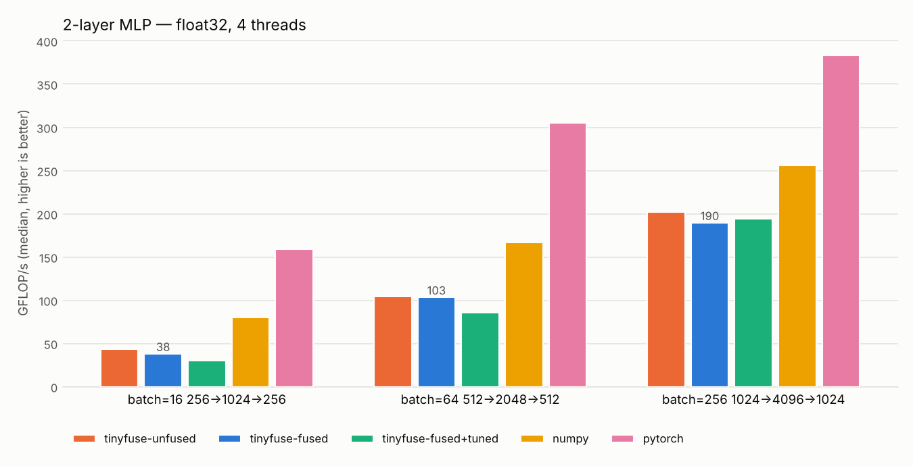
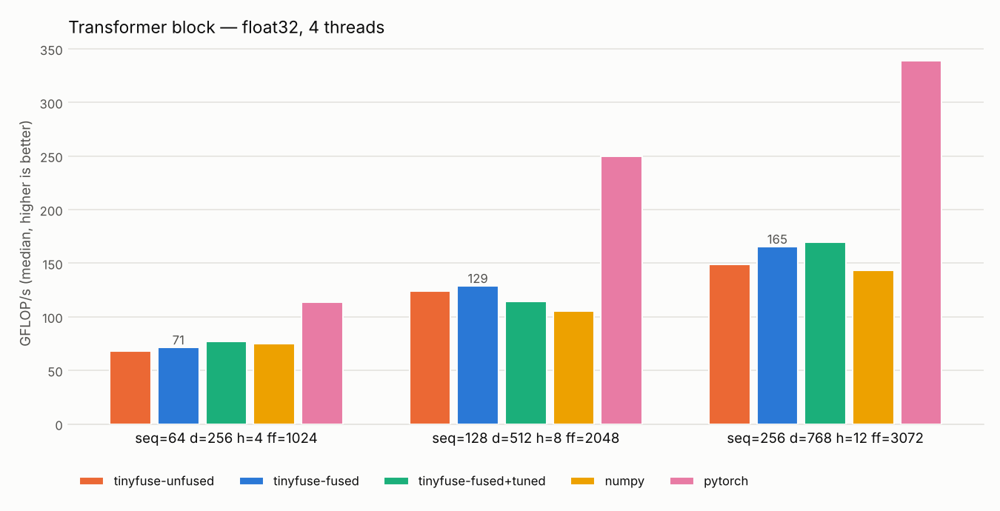

# tinyfuse

[](https://github.com/PS12007/tinyfuse/actions/workflows/tests.yml)

tinyfuse is a small ML compiler I wrote in Python and C. You write a model as
ordinary Python using a NumPy-like API. tinyfuse traces it into a graph,
optimizes and fuses the graph, generates C with tiled, vectorized loops,
compiles that C with `gcc -O3 -march=native`, and calls it through `ctypes`.

It handles a 2-layer MLP and a full transformer block (multi-head attention,
GELU MLP, layernorm, residuals). On one core it runs them 1.2 to 1.7 times
faster than the same code in NumPy.



**Contents:** [Quick start](#quick-start) ·
[How it works](#how-it-works) · [Results](#results) ·
[Things that went wrong](#things-that-went-wrong-along-the-way) ·
[Tests](#tests) · [Limitations](#limitations) · [Repo layout](#repo-layout)

## Quick start

You need Python 3.9+, NumPy and GCC. For the benchmarks you also need
matplotlib and PyTorch.

```bash
pip install numpy pytest
```

```python
import numpy as np
import tinyfuse as tf

def mlp(x, w1, b1, w2, b2):
    return tf.relu(x @ w1 + b1) @ w2 + b2

f = tf.compile(mlp, x=(32, 64), w1=(64, 128), b1=(128,), w2=(128, 10), b2=(10,))

print(f.graph)       # IR as traced
print(f.optimized)   # IR after the passes
print(f.source)      # the generated C
y = f(x, w1, b1, w2, b2)   # NumPy arrays in, NumPy arrays out
```

Run the tests (291 of them, about 20 seconds; the first run spends most of
that compiling C):

```bash
python -m pytest -q
```

Other entry points:

```bash
python examples/demo.py                      # the run in the GIF above
```

```bash
python examples/show_transformer_ir.py       # transformer IR before/after fusion
```

```bash
python benchmarks/run_benchmarks.py --threads 1
```

```bash
python -m tinyfuse.autotune --shape 256x1024x4096 --db my_tuning.json
```

```bash
python docs/make_figures.py                  # regenerate every image in this README
```

Supported ops: `matmul` (2-D and batched), `add`, `sub`, `mul`, `div`,
`maximum`, `relu`, `gelu` (tanh form), `sigmoid`, `tanh`, `exp`, `neg`,
`softmax` and `layernorm` (last axis), `reshape`, `transpose`.

## How it works

There are four stages: trace, optimize, generate C, run. The reasoning behind
each decision is in [DESIGN.md](DESIGN.md). This section is the short version.

### 1. Tracing into a graph

`tf.compile` calls your function with symbolic tensors. Each operation adds a
node to a graph, and Python control flow simply runs during tracing, the same
way `torch.fx` or `jax.jit` work. Every node has a static float32 shape, which
is inferred the moment the node is created. So a shape mismatch fails on the
line that caused it, not later inside the compiler.

The IR is a flat SSA graph. Every op has a NumPy reference implementation. That
implementation is the definition of what the op means: the interpreter, the
constant folder and the tests all use it. There is a verifier that checks
operand order, arity, shapes and fused-op programs, and the pass manager runs
it after every pass.

### 2. Optimizing and fusing

The `fused` pipeline runs constant folding, CSE and DCE, then two fusion passes
and a layout pass:

* **Matmul epilogue fusion.** Starting at each matmul, it follows the chain of
  elementwise ops that consume the result: bias add, activation, residual add,
  scaling. Each must be the previous op's only user, and the shape must not
  change. The whole chain becomes the matmul's *epilogue*, a small expression
  evaluated on each output tile.
* **Elementwise fusion.** Whatever elementwise chains are left get merged into
  single loops. A node joins a group only if all of its users are already in
  that group. That rule is what guarantees fusion can never create a cycle.
* **Layout folding.** A transpose, or a reshape of contiguous data, is just a
  strided view of its input. When one feeds a matmul, the matmul reads the
  original buffer through those strides during packing, and the transpose
  kernel disappears. In attention that removes the q/k/v head splits and `k^T`.

On the transformer block this takes 29 ops down to 13, and 25 kernels down
to 12:



The printed IR shows the same thing. Here is a 2-layer MLP before:

```
graph mlp(%x: f32[32,64], %w1: f32[64,128], %b1: f32[128], %w2: f32[128,10], %b2: f32[10]) {
  %0: f32[32,128] = matmul(%x, %w1)
  %1: f32[32,128] = add(%0, %b1)
  %2: f32[32,128] = relu(%1)
  %3: f32[32,10] = matmul(%2, %w2)
  %4: f32[32,10] = add(%3, %b2)
  return %4
}
```

and after:

```
graph mlp(%x: f32[32,64], %w1: f32[64,128], %b1: f32[128], %w2: f32[128,10], %b2: f32[10]) {
  %0: f32[32,128] = fused_matmul(%x, %w1, %b1) {epilogue=[t0=add(acc,in0); t1=relu(t0)]}
  %1: f32[32,10] = fused_matmul(%0, %w2, %b2) {epilogue=[t0=add(acc,in0)]}
  return %1
}
```

In the transformer the residual add is absorbed too, and the attention scores
read q and `k^T` straight out of the projection outputs:

```
%4: f32[4,64,64] = fused_matmul(%1, %2) {a_view=f32[4,64,64] strides [64,256,1],
                     b_view=f32[4,64,64] strides [64,1,256], epilogue=[t0=mul(acc,0.125)]}
%9: f32[64,256]  = fused_matmul(%8, %wo, %bo, %x) {epilogue=[t0=add(acc,in0); t1=add(in1,t0)]}
```

Layout folding is correct and tested, but I couldn't measure a speedup from
it: the transposes were only about 2% of the runtime, and reading `k^T`
through a strided gather while packing costs some of that back.

### 3. Generating C

The whole graph becomes one C file. Each node gets its own `static` function
with every shape baked in as a constant, and a single `tf_run()` calls them in
order, so one call from Python runs the entire model.

The matmul kernel is where most of the time goes, so it got most of the
effort. It follows the GotoBLAS structure. Blocks of A and B are copied
("packed") into small contiguous panels. Then a micro-kernel computes a 6×64
tile of C while keeping all of it in 24 AVX-512 registers, written with GCC
vector extensions. When the last K block of a cache block is done, the fused
epilogue runs over that block while it is still in cache:



My first version left the vectorizing to GCC, using a plain `float acc[6][32]`.
GCC kept that array on the stack and the kernel ran at 1.8 GFLOP/s. With
explicit vector types and direct loads it reaches 95 to 125 GFLOP/s on one core
of this machine, slightly ahead of OpenBLAS at these sizes.

Elementwise kernels, fused or not, merge every dimension that is contiguous for
all of their operands and emit a single `#pragma omp simd` loop that evaluates
the fused expression in registers. Softmax and layernorm are row kernels with
SIMD reductions. Transpose is either a vectorized row copy or a 32×32 tiled
copy. Reshape compiles to nothing.

The tile sizes can be autotuned. For each matmul shape, including its
epilogue, the tuner times up to 32 candidate tiles, re-times the best few
against the default (interleaved, to cancel out noise), and stores the winner
in `benchmarks/tuning.json`.

### 4. Memory

Intermediate tensors live in one preallocated workspace. A greedy best-fit
planner assigns offsets based on when each tensor is first written and last
read, so tensors whose lifetimes don't overlap share memory. Outputs are
written straight into the arrays returned to the caller.



Fusion removes the elementwise intermediates altogether, which is why the
fused workspace is 40% smaller.

## Results

Setup: one cloud VM with an Intel Xeon @ 2.80 GHz (4 vCPUs, AVX-512), GCC 13.3,
NumPy 2.5.3 (OpenBLAS), PyTorch 2.15 on CPU in eager mode. Each variant's output
is checked against NumPy before it is timed. The numbers are medians. Raw data
is in `docs/benchmarks_1t.csv` and `docs/benchmarks_4t.csv`. They were measured
before layout folding was added; an A/B run with and without it differed by
less than 1.5% on every transformer size.

The five variants: tinyfuse with cleanup passes but no fusion (`unfused`), with
fusion (`fused`), with fusion and autotuned tiles (`fused+tuned`), the same
model in plain NumPy, and PyTorch.

### One thread




| ms per call, 1 thread | unfused | fused | fused+tuned | NumPy | PyTorch |
|---|---:|---:|---:|---:|---:|
| MLP 16 × 256→1024→256 | 0.337 | 0.317 | 0.282 | 0.398 | **0.261** |
| MLP 64 × 512→2048→512 | 3.114 | 3.001 | **2.965** | 3.698 | 3.105 |
| MLP 256 × 1024→4096→1024 | 38.95 | 37.45 | 37.46 | 44.62 | **35.34** |
| Transformer seq 64, d 256 | 1.381 | 1.333 | **1.267** | 2.098 | 1.626 |
| Transformer seq 128, d 512 | 9.074 | 8.893 | **8.458** | 13.97 | 11.78 |
| Transformer seq 256, d 768 | 39.20 | 37.48 | **36.22** | 51.14 | 38.13 |

tinyfuse beats NumPy on every row, and it beats PyTorch eager on all three
transformer sizes. PyTorch is faster on the smallest and the largest MLP.

Fusion is not where most of that speedup comes from. The profiler built into
the generated code (`CodegenOptions(profile=True)`) shows why:



These models spend about 90% of their time in matmul. Fusion deletes the
separate elementwise kernels, but their arithmetic still runs, now inside the
matmul epilogue. What's saved is the memory traffic and the extra kernels,
which comes to 2 to 6% end to end here. Most of the gap over NumPy comes from
the matmul kernel itself, and from running the whole model in one native call
instead of one Python-dispatched op at a time. A graph made of long elementwise
chains would benefit far more from fusion than these do.

### Four threads

With `CodegenOptions(parallel=True)` tinyfuse uses OpenMP, and every library
gets 4 threads. Here each variant is timed in its own block rather than
interleaved: when the variants alternated, the three thread pools (OpenMP,
OpenBLAS and PyTorch's) kept fighting each other for the 4 cores.




| ms per call, 4 threads | unfused | fused | fused+tuned | NumPy | PyTorch |
|---|---:|---:|---:|---:|---:|
| MLP 16 × 256→1024→256 | 0.202 | 0.181 | 0.169 | 0.223 | **0.101** |
| MLP 64 × 512→2048→512 | 2.170 | 1.972 | 2.171 | 1.723 | **0.859** |
| MLP 256 × 1024→4096→1024 | 19.00 | 17.74 | 17.48 | 18.33 | **11.66** |
| Transformer seq 64, d 256 | 1.097 | 1.112 | 1.033 | 1.442 | **0.826** |
| Transformer seq 128, d 512 | 5.469 | 5.192 | 5.478 | 7.569 | **3.186** |
| Transformer seq 256, d 768 | 20.51 | 17.09 | 16.76 | 27.10 | **10.99** |

Multithreaded, PyTorch wins every row by 1.35 to 2.3 times. tinyfuse still beats
NumPy on the transformer block and roughly ties it on the MLPs. The threading
is the weakest part of the project; see [Limitations](#limitations).

## Things that went wrong along the way

These are written up because they took a while to track down, and the first
two had me drawing the wrong conclusions for a while.

**Misaligned buffers made matmul 1.4× slower, but only some of the time.**
NumPy only guarantees 16-byte alignment, and big arrays usually start 16 bytes
past a page boundary. Every 64-byte AVX-512 load from a misaligned buffer
straddles two cache lines. Whether a compiled model was fast or slow depended
on where the allocator happened to put its workspace. For a while it looked as
if fusion was making matmuls slower and the autotuner was picking bad tiles.
Now every buffer tinyfuse allocates is 64-byte aligned, and a test checks it.

**GELU was 10× slower on big activations.** GELU is computed as
`x / (1 + exp(-2y))`. With large inputs the `exp` underflows, and glibc's
vectorized `expf` falls back to a slow scalar path when that happens.
Clamping the exponent to ±80 fixed it; the effect on the result is below
1e-34.

**Interleaved multithreaded benchmarks measured the wrong thing.** The first
4-thread run gave medians 2 to 25 times larger than the minimums, because each
library's idle threads kept spinning and stole cores from whichever library ran
next. I switched to timing each variant in its own block.

**The first parallel matmul was slower than the serial one** on small
problems, because it started a new OpenMP team for every cache block. It now
uses one parallel region per kernel, with per-thread packing.

## Tests

Every op, the MLP and the transformer block are compared with NumPy in float64,
with `rtol = atol = 1e-4`.

| File | What it covers |
|---|---|
| `test_frontend.py` | tracing, operator overloading, trace-time shape errors |
| `test_ir.py` | shape inference, exact printer output, the verifier rejecting 10 kinds of broken IR |
| `test_pass_*.py` | each pass, layout folding included: exact IR before and after, same results through the interpreter, cases that must *not* fuse or fold |
| `test_codegen_ops.py` | every op through C at odd sizes and with every broadcast pattern; tiny tiles that force every edge path in the matmul; aliased and duplicated outputs; alignment; the profiler |
| `test_models.py` | MLP and transformer at 4 sizes × 3 pipelines, a PyTorch cross-check, OpenMP builds |
| `test_fuzz.py` | 40 random graphs, each compiled 4 ways, compared with the interpreter |
| `test_memory.py` | live buffers never overlap, and reuse actually saves memory |
| `test_autotune.py` | the search space, the tuning database, precedence of explicit tiles, the CLI |

## Limitations

* Static shapes, float32 and inference only. A new input shape means
  re-tracing and recompiling (compiled code is cached by a hash of its source).
  There is no autodiff and no low-precision types.
* The op set is small. There is no concat, slicing, gather, convolution or
  general reduction. Softmax and layernorm only reduce over the last axis, and
  batched matmul needs identical batch dimensions.
* Fusion is local. Layernorm and softmax are never fused with their
  neighbours, and there is nothing like flash attention. Transposes that feed a
  matmul are folded away, but a transpose of a matmul's *output* (the head
  merge after `att @ v`) is still materialized.
* The matmul is good but not BLAS-grade everywhere: no prefetching, no
  assembly, and weights are re-packed on every call even when they are
  constants. It is tuned for AVX-512; AVX2 machines run the same code with
  much less tuning behind it.
* Threading is basic. There is one fork/join per kernel rather than one per
  graph, no NUMA awareness, and the autotuner only tunes single-threaded. A
  compiled function is not safe to call from several threads at once, because
  its workspace is shared.
* The C is built with `-ffast-math`, which glibc needs before it will use its
  vectorized `expf`/`tanhf`. Results can differ from NumPy in the last few bits,
  and NaN or inf inputs give unspecified results.
* It assumes GCC on Linux with glibc. The compiled `.so` files are specific to
  the CPU that built them.
* All benchmarks come from one shared cloud VM, with run-to-run swings of up to
  30%. PyTorch was run in eager mode, not with `torch.compile`.

## Repo layout

| Path | Contents |
|---|---|
| `tinyfuse/frontend.py` | `Tensor`, operator overloading, `trace()` |
| `tinyfuse/ops.py` | op registry: shape rules plus NumPy semantics |
| `tinyfuse/ir.py` | graph, printer, verifier |
| `tinyfuse/passes/` | constant folding, CSE, DCE, both fusion passes, layout folding, pass manager |
| `tinyfuse/codegen/` | C emitter and memory planner |
| `tinyfuse/runtime.py` | gcc invocation, `.so` cache, `ctypes` wrapper, aligned buffers, profiler |
| `tinyfuse/autotune.py` | tile search and the tuning database |
| `tinyfuse/models.py` | the MLP and transformer block used by tests and benchmarks |
| `benchmarks/` | benchmark runner, chart script, tuning database |
| `docs/` | benchmark CSVs and charts, `make_figures.py`, images in `docs/img/` |
| `DESIGN.md` | design decisions and why |
