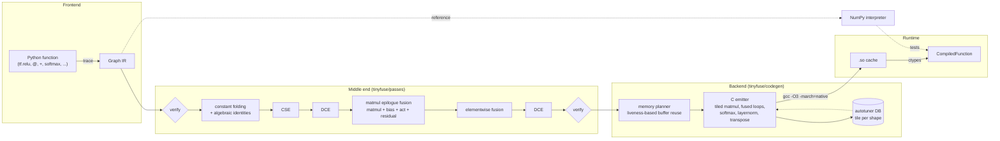

# tinyfuse

A small ML compiler in Python + C. It **traces** NumPy-style Python code into a
graph IR, **optimizes** it (constant folding, CSE, DCE, elementwise fusion,
matmul + bias + activation fusion), **generates C** with cache tiling and
register-blocked SIMD micro-kernels, compiles that with
`gcc -O3 -march=native`, and runs it through `ctypes`.

```python
import numpy as np
import tinyfuse as tf

def mlp(x, w1, b1, w2, b2):
    return tf.relu(x @ w1 + b1) @ w2 + b2

f = tf.compile(mlp, x=(32, 64), w1=(64, 128), b1=(128,), w2=(128, 10), b2=(10,))
print(f.optimized)        # IR after the passes
y = f(x, w1, b1, w2, b2)  # NumPy arrays in, NumPy arrays out
```

* ~2.7k lines of Python; no dependencies besides NumPy and a C compiler.
* Ops: `matmul` (2-D and batched), `add`, `sub`, `mul`, `div`, `maximum`, `relu`,
  `gelu`, `sigmoid`, `tanh`, `exp`, `neg`, `softmax`, `layernorm`, `reshape`,
  `transpose`.
* 266 tests. Every op, a 2-layer MLP and a transformer block are checked against
  NumPy at `rtol = atol = 1e-4`, plus randomized differential fuzzing.
* Single-threaded, it is **1.2–1.7× faster than NumPy/OpenBLAS** on these
  models, and on par with or faster than PyTorch eager on the transformer
  block. **With 4 threads, PyTorch is 1.35–2.3× faster than it**. Numbers
  [below](#benchmarks).

Design decisions and their rationale are in **[DESIGN.md](DESIGN.md)**.

## Architecture



| Module | What it does |
|---|---|
| `tinyfuse/frontend.py` | `Tensor` with operator overloading; `trace()` builds the graph |
| `tinyfuse/ops.py` | op registry: shape inference + NumPy reference semantics per op |
| `tinyfuse/ir.py` | `Node`/`Graph`, pretty printer, verifier, toposort |
| `tinyfuse/interpreter.py` | runs a graph with the NumPy semantics (ground truth for tests) |
| `tinyfuse/passes/` | constant folding, CSE, DCE, elementwise fusion, matmul epilogue fusion, pass manager |
| `tinyfuse/codegen/` | memory planner and C emitter |
| `tinyfuse/runtime.py` | gcc invocation, `.so` cache, `ctypes` wrapper, aligned buffers, profiler |
| `tinyfuse/autotune.py` | tile-size search per matmul shape, persistent `TuningDB` |
| `tinyfuse/models.py` | the MLP and transformer block used by tests and benchmarks |

## The IR, before and after fusion

The transformer block from `tinyfuse/models.py` (pre-LayerNorm, multi-head
attention, GELU MLP, residuals), as traced:

```
graph block(%x: f32[64,256], %ln1_g: f32[256], ..., %w2: f32[1024,256], %b2: f32[256]) {
  %0: f32[64,256] = layernorm(%x, %ln1_g, %ln1_b) {eps=1e-05}
  %1: f32[64,256] = matmul(%0, %wq)
  %2: f32[64,256] = add(%1, %bq)
  %3: f32[64,4,64] = reshape(%2) {shape=[64,4,64]}
  %4: f32[4,64,64] = transpose(%3) {perm=[1,0,2]}
  ...                                                     (k and v: same pattern)
  %13: f32[4,64,64] = matmul(%4, %8)
  %14: f32[] = const() {value=0.125}
  %15: f32[4,64,64] = mul(%13, %14)
  %16: f32[4,64,64] = softmax(%15) {axis=-1}
  %17: f32[4,64,64] = matmul(%16, %12)
  %18: f32[64,4,64] = transpose(%17) {perm=[1,0,2]}
  %19: f32[64,256] = reshape(%18) {shape=[64,256]}
  %20: f32[64,256] = matmul(%19, %wo)
  %21: f32[64,256] = add(%20, %bo)
  %22: f32[64,256] = add(%x, %21)
  %23: f32[64,256] = layernorm(%22, %ln2_g, %ln2_b) {eps=1e-05}
  %24: f32[64,1024] = matmul(%23, %w1)
  %25: f32[64,1024] = add(%24, %b1)
  %26: f32[64,1024] = gelu(%25)
  %27: f32[64,256] = matmul(%26, %w2)
  %28: f32[64,256] = add(%27, %b2)
  %29: f32[64,256] = add(%22, %28)
  return %29
}
```

After the `fused` pipeline, 30 ops become 19. Every bias, the attention scale,
GELU and both residual adds now run inside matmul epilogues, and reshapes cost
nothing:

```
graph block(...) {
  %0: f32[64,256] = layernorm(%x, %ln1_g, %ln1_b) {eps=1e-05}
  %1: f32[64,256] = fused_matmul(%0, %wq, %bq) {epilogue=[t0=add(acc,in0)]}
  %2: f32[64,4,64] = reshape(%1) {shape=[64,4,64]}
  %3: f32[4,64,64] = transpose(%2) {perm=[1,0,2]}
  ...
  %10: f32[4,64,64] = fused_matmul(%3, %6) {epilogue=[t0=mul(acc,0.125)]}
  %11: f32[4,64,64] = softmax(%10) {axis=-1}
  %12: f32[4,64,64] = matmul(%11, %9)
  %13: f32[64,4,64] = transpose(%12) {perm=[1,0,2]}
  %14: f32[64,256] = reshape(%13) {shape=[64,256]}
  %15: f32[64,256] = fused_matmul(%14, %wo, %bo, %x) {epilogue=[t0=add(acc,in0); t1=add(in1,t0)]}
  %16: f32[64,256] = layernorm(%15, %ln2_g, %ln2_b) {eps=1e-05}
  %17: f32[64,1024] = fused_matmul(%16, %w1, %b1) {epilogue=[t0=add(acc,in0); t1=gelu(t0)]}
  %18: f32[64,256] = fused_matmul(%17, %w2, %b2, %15) {epilogue=[t0=add(acc,in0); t1=add(in1,t0)]}
  return %18
}
```

Elementwise chains that don't follow a matmul become one loop. From
`tests/test_pass_fusion.py`:

```
graph f(%x: f32[4,8], %y: f32[4,8], %z: f32[8]) {        graph f(%x: f32[4,8], %y: f32[4,8], %z: f32[8]) {
  %0: f32[4,8] = mul(%x, %y)                                %0: f32[4,8] = fused_elementwise(%x, %y, %z)
  %1: f32[4,8] = add(%0, %z)                         ==>        {program=[t0=mul(in0,in1); t1=add(t0,in2);
  %2: f32[4,8] = gelu(%1)                                                t2=gelu(t1); t3=sub(t2,1)]}
  %3: f32[] = const() {value=1.}                            return %0
  %4: f32[4,8] = sub(%2, %3)                              }
  return %4
}
```

Run `python examples/show_transformer_ir.py` to print the full IR, or look at
`f.source` to see the generated C.

## Code generation in one paragraph

Each node becomes a `static` C function specialized to its static shapes, and
one `tf_run(float**)` entry point calls them in order. **Matmul** is
GotoBLAS-style: it packs A and B into zero-padded panels and computes 6×64 float
micro-tiles held in 24 AVX-512 registers through GCC vector extensions. The
fused **epilogue** runs over each finished cache block while it is still in L2.
**Elementwise** kernels merge dimensions that are contiguous for all operands and
emit one `omp simd` loop that evaluates the fused program in registers.
**Softmax/LayerNorm** are row kernels with SIMD reductions. **Transpose** is a
vectorized row copy or a 32×32-tiled copy. **Memory** is planned by liveness
(greedy best fit), outputs are written straight into the caller's arrays, and
every buffer is 64-byte aligned.

## Running it

```bash
pip install numpy pytest          # + matplotlib torch for the benchmarks
```

```bash
python -m pytest -q               # 266 tests, ~20 s (first run compiles C)
```

```bash
python examples/quickstart.py
```

```bash
python benchmarks/run_benchmarks.py --threads 1 && python benchmarks/plot.py docs/benchmarks_1t.csv
```

```bash
python -m tinyfuse.autotune --shape 256x1024x4096 --db my_tuning.json
```

Useful knobs: `tf.compile(fn, ..., pipeline="none"|"unfused"|"fused",
options=CodegenOptions(parallel=True, profile=True, default_tile=MatmulTile(...)),
tuning=TuningDB(path))`. Compiled `.so` files are cached in `$TINYFUSE_CACHE`
(default: `/tmp/tinyfuse_cache`).

## Benchmarks

Setup: Intel Xeon @ 2.80 GHz (cloud VM, 4 vCPUs, AVX-512), GCC 13.3, Python 3.13,
NumPy 2.5.3 (OpenBLAS), PyTorch 2.15.0 CPU. float32. Every variant's output is
checked against NumPy before timing. Single-threaded, variants run
**interleaved**, one call each per round, for many rounds. Multi-threaded,
interleaving makes the thread pools of OpenMP, OpenBLAS and PyTorch fight for
the 4 cores (medians came out 2–25× the minimums), so each variant instead runs
in its own warmed-up block, over 3 passes. We report the median. Raw data:
`docs/benchmarks_*.csv`; environment: `docs/benchmarks_*_env.txt`.

* **tinyfuse-unfused**: cleanup passes only, one kernel per op (still our tiled C kernels).
* **tinyfuse-fused**: the full pipeline.
* **tinyfuse-fused+tuned**: fused, with autotuned tiles from `benchmarks/tuning.json`.
* **numpy**: the same model written in NumPy (OpenBLAS sgemm).
* **pytorch**: eager mode, `torch.no_grad()`, the same tanh-GELU.

### Single thread


Median ms per call (speedup vs NumPy):

| MLP (batch, in→hidden→out) | unfused | fused | fused+tuned | numpy | pytorch |
|---|---:|---:|---:|---:|---:|
| 16, 256→1024→256 | 0.337 (×1.18) | 0.317 (×1.25) | 0.282 (×1.41) | 0.398 | 0.261 (×1.52) |
| 64, 512→2048→512 | 3.114 (×1.19) | 3.001 (×1.23) | 2.965 (×1.25) | 3.698 | 3.105 (×1.19) |
| 256, 1024→4096→1024 | 38.95 (×1.15) | 37.45 (×1.19) | 37.46 (×1.19) | 44.62 | 35.34 (×1.26) |

| Transformer block (seq, d, heads, ff) | unfused | fused | fused+tuned | numpy | pytorch |
|---|---:|---:|---:|---:|---:|
| 64, 256, 4, 1024 | 1.381 (×1.52) | 1.333 (×1.57) | 1.267 (×1.66) | 2.098 | 1.626 (×1.29) |
| 128, 512, 8, 2048 | 9.074 (×1.54) | 8.893 (×1.57) | 8.458 (×1.65) | 13.97 | 11.78 (×1.19) |
| 256, 768, 12, 3072 | 39.20 (×1.30) | 37.48 (×1.36) | 36.22 (×1.41) | 51.14 | 38.13 (×1.34) |

### Four threads

tinyfuse uses `CodegenOptions(parallel=True)` (OpenMP); NumPy/OpenBLAS and
PyTorch use 4 threads.


| MLP (batch, in→hidden→out) | unfused | fused | fused+tuned | numpy | pytorch |
|---|---:|---:|---:|---:|---:|
| 16, 256→1024→256 | 0.202 (×1.11) | 0.181 (×1.24) | 0.169 (×1.32) | 0.223 | 0.101 (×2.21) |
| 64, 512→2048→512 | 2.170 (×0.79) | 1.972 (×0.87) | 2.171 (×0.79) | 1.723 | 0.859 (×2.00) |
| 256, 1024→4096→1024 | 19.00 (×0.96) | 17.74 (×1.03) | 17.48 (×1.05) | 18.33 | 11.66 (×1.57) |

| Transformer block (seq, d, heads, ff) | unfused | fused | fused+tuned | numpy | pytorch |
|---|---:|---:|---:|---:|---:|
| 64, 256, 4, 1024 | 1.097 (×1.31) | 1.112 (×1.30) | 1.033 (×1.40) | 1.442 | 0.826 (×1.75) |
| 128, 512, 8, 2048 | 5.469 (×1.38) | 5.192 (×1.46) | 5.478 (×1.38) | 7.569 | 3.186 (×2.38) |
| 256, 768, 12, 3072 | 20.51 (×1.32) | 17.09 (×1.59) | 16.76 (×1.62) | 27.10 | 10.99 (×2.47) |

### What the numbers say

* **Most of the win over NumPy comes from the matmul kernel and from running the
  whole graph in one native call, not from fusion.** Our single-threaded
  matmul reaches 95–125 GFLOP/s at these shapes, a bit above OpenBLAS's sgemm on
  this machine. NumPy also pays per-op Python dispatch and allocates a fresh
  array for every intermediate.
* **Fusion itself is worth 2–6 % here.** These models are matmul-bound: the
  elementwise work that fusion removes (bias, GELU, residual, scale) is a few
  percent of the FLOPs, and the epilogue still has to do the arithmetic. Fusion
  matters more for memory-bound graphs with long elementwise chains, but these
  benchmarks don't show that.
* **The autotuner adds 0–12 %**, mostly on small shapes, where the default tile
  is too large for the problem.
* **PyTorch eager** is faster on the smallest and the largest MLP. Its MKL/oneDNN
  GEMM beats ours on large square-ish problems.
* **Multi-threaded, PyTorch is clearly ahead.** At 4 threads PyTorch eager is
  1.35–2.3× faster than tinyfuse-fused. tinyfuse beats NumPy on the transformer
  block (1.3–1.6×) and is roughly level with it on the MLPs (0.87–1.05×).
  tinyfuse-fused scales 1.2–2.2× from 1 to 4 threads. Our first threading
  design scaled 0.7–1.65×, because it forked an OpenMP team for every cache
  block; the current design uses one parallel region per kernel with
  per-thread packing (see DESIGN.md). The remaining gap is in the GEMM itself:
  no prefetching, tiles tuned for one thread, and a fork/join per kernel rather
  than one per graph.
* **The multi-threaded numbers are noisier.** On this VM the medians still sit
  10–60 % above the minimums at 4 threads.

## Testing

| Suite | What it checks |
|---|---|
| `test_frontend.py` | tracing, operator overloads, named shapes, trace-time shape errors |
| `test_ir.py` | shape inference, printer format, verifier rejects 10 kinds of malformed IR, toposort/cycles |
| `test_pass_*.py` | exact before/after IR for each pass, interpreter equivalence, negative cases |
| `test_codegen_ops.py` | every op through C vs NumPy: odd sizes, every broadcast pattern, batched matmul, tiny tiles to hit all edge paths, special outputs (aliases, duplicates, constants), alignment, profiler |
| `test_models.py` | MLP and transformer block at 4 sizes × 3 pipelines vs NumPy (1e-4), plus vs PyTorch |
| `test_fuzz.py` | 40 random graphs × 3 compile configurations vs the interpreter |
| `test_memory.py` | planner never overlaps live buffers; reuse shrinks the workspace |
| `test_autotune.py` | candidate space, DB round-trip, precedence of explicit tiles, CLI |

## Limitations

* **Static shapes, float32, inference only.** A new shape means a retrace and a
  recompile (compiles are cached by source hash). No autodiff, no
  int8/bf16/fp16, no dynamic dims.
* **Small op set.** Softmax and layernorm reduce over the last axis only. Matmul
  batch dims must match exactly (or B is 2-D). There is no concat, slice, gather,
  conv or general reductions.
* **Fusion is local.** Layernorm and softmax are never fused with neighbours
  (no fused "layernorm → matmul" prologue). Transposes are always materialized,
  including `k^T` in attention. There is no flash-attention-style fusion. A value
  that feeds two different groups is materialized, never recomputed.
* **The matmul is good, not BLAS-grade everywhere.** No prefetching and no
  hand-written assembly. It is tuned for AVX-512; AVX2 and narrower targets work
  through the same vector-extension code but get much less tuning. Packing
  buffers are rebuilt on every call, even for constant weights.
* **Threading is basic.** With `parallel=True`, each matmul kernel runs one
  OpenMP region over (row block × panel) units with per-thread A packing, and
  elementwise and row kernels parallelize their outer loop. There is a fork/join
  per kernel (not per graph), no NUMA awareness, and the autotuner tunes
  single-threaded. A compiled function is **not reentrant**, because its
  workspace is shared between calls.
* **`-ffast-math`.** It is needed for vectorized `expf`/`tanhf` (glibc libmvec).
  Results can differ from NumPy in the last bits, and NaN/inf inputs give
  unspecified results.
* **GCC + Linux/glibc assumed** for the vector extensions, libmvec and
  `-march=native`. The generated `.so` is not portable to other CPUs.
* **The autotuner is simple.** Random sampling of a pruned space with a
  confirmation round; single-threaded tuning; results are keyed by CPU model.
  It does not tune elementwise or transpose kernels.
* **Benchmark caveats.** One machine, a shared and noisy cloud VM (we saw ±30 %
  swings between runs, which is why variants are interleaved). PyTorch is eager,
  not `torch.compile`. NumPy and PyTorch use a different GEMM than ours.
